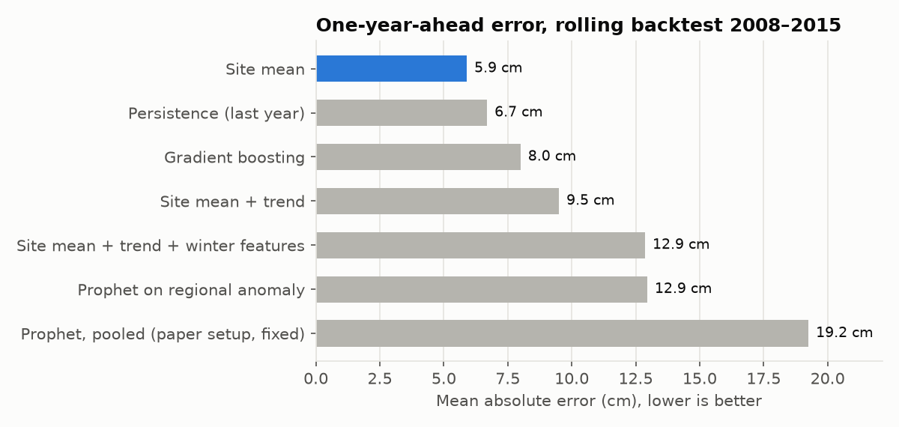
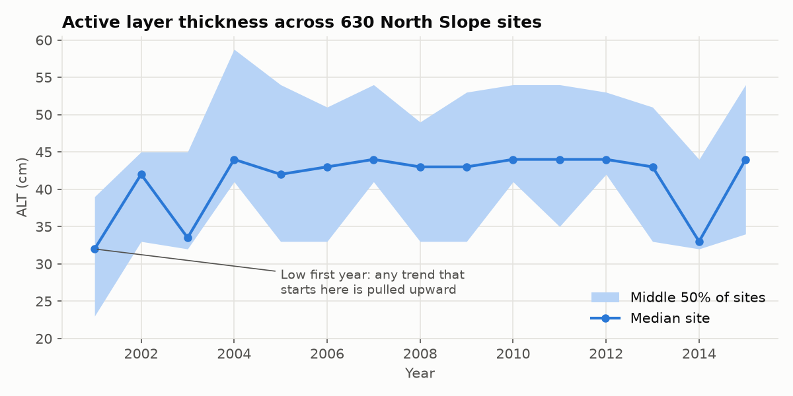
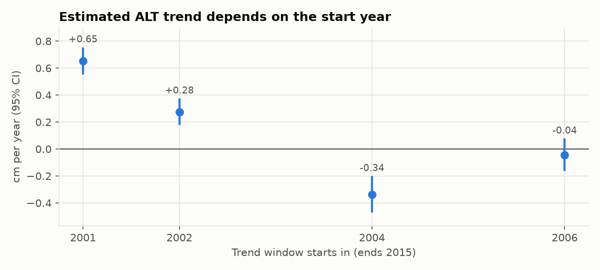

# Forecasting permafrost active layer thickness in northern Alaska

How deep does the ground thaw each summer on Alaska's North Slope, and can we forecast it?
This repo started as a 2025 ASDRP research project and was later **re-audited and rebuilt**.
The rebuild found that the original model's conclusions were driven by a feature bug, and
that a simple per-site baseline beats every model we tried.

**Main notebook:** [`alt_forecasting.ipynb`](alt_forecasting.ipynb) (runs end-to-end in about a minute)

## Results at a glance

| | Original project | Rebuilt |
|---|---|---|
| Weather inputs per site | identical in every year (bug) | interpolated per site **and** per year |
| Evaluation | one split, many-to-many join, "RMSE" was MSE | rolling-origin backtest, 8 test years, baselines |
| Best model | Prophet (MAE reported as 19.3 cm) | **per-site mean, MAE 5.9 cm** |
| Prophet, same setup | — | MAE 19.2 cm, 3× worse than the baseline |
| ALT trend 2001–2015 | "stable or slightly decreasing" | **no robust trend**: sign flips with start year |
| Air temperature effect | negative (physically backwards) | positive, small |



### 1. There is no robust trend
The median site's ALT is roughly flat at 42–44 cm, with low years in 2001, 2003 and 2014.
A site fixed-effects regression gives +0.65 cm/yr if the window starts in 2001, but −0.34 cm/yr from
2004 and about zero from 2006. Fifteen years of data can't separate a climate signal from a few odd years.




### 2. A site's own history is the best forecast
72% of ALT variance is between sites, not between years. Each model is fit on years before T and
scored on year T, for T = 2008–2015. The site mean wins; models with a trend over-forecast because the
early rise keeps extrapolating. Pooling all 630 sites into one Prophet series (the paper's setup)
discards the between-site differences that make up most of the variance.

### 3. Winter conditions carry little signal, and the reason is in the data
The station data only covers **September–May**, so the summer thaw season, the main physical driver
of ALT, is missing. Winter features are paired with the *following* summer's ALT, which makes this a true
pre-season forecast. The effects now have physically sensible signs (more snow insulates the ground → deeper
thaw; warmer winter → deeper thaw) but explain under 1% of within-site variation and don't improve forecasts.

## What was wrong with the original
The original notebooks are preserved unchanged in [`archive/`](archive/).
1. **Features ignored time.** Inverse-distance weights were computed over every station-*year* row, so each site
   received the same weather values in all 15 years. The model could only learn location, not weather.
2. **Coefficients had the wrong sign** as a result (warmer air → thinner active layer), and were reported as
   "feature importance" in the paper.
3. **Evaluation join.** Predictions and observations were merged on year alone, pairing every site with every other site.
4. **RMSE was MSE** (`mean_squared_error` without the square root: "773" was really ~28 cm).
5. **The 20-year forecast held all inputs at one arbitrary site's last value**, so it was a trend line.
6. **No baseline**, so "MAE 19 cm" had no reference point.

## Data
* **ALT:** Yi, Y. & Kimball, J.S. (2020). *ABoVE: Active Layer Thickness from Remote Sensing Permafrost Model,
  Alaska, 2001–2015.* ORNL DAAC. [doi:10.3334/ORNLDAAC/1760](https://doi.org/10.3334/ORNLDAAC/1760).
  Filtered to the northern cluster (630 grid cells). This is itself model output, not in-situ measurement.
* **Station conditions:** Laboor, S. (2016). *Near-Surface Permafrost Conditions from Synthesis Data, 1997–2016, Alaska.*
  Arctic Permafrost Geospatial Centre. Six stations, monthly, gap-filled.

Both are included in [`data/`](data/) as used in the project.

## Run it
```bash
python3 -m venv .venv && .venv/bin/pip install -r requirements.txt
.venv/bin/jupyter nbconvert --to notebook --execute --inplace alt_forecasting.ipynb
```
Code lives in [`src/`](src/): `features.py` (per-year IDW interpolation), `backtest.py` (models + rolling backtest),
`plots.py` (figures).

## Next steps
1. Add summer thaw-degree-days (ERA5-Land or station Jun–Aug records), the main physical driver.
2. Validate against in-situ ALT from the CALM network instead of a model-derived target.
3. Extend past 2015 so trend estimates aren't dominated by one year.
4. Then try hierarchical models or a time-series foundation model (e.g. TimesFM), scored against the site-mean baseline.

## Credits
Original project: *Forecasting permafrost active layer thickness changes in northern Alaska*, by Dheeksha Baskaran\*,
Varun Dangeti\*, Nikhil Gummadidala, Sarah Wu, Saanvi Kumar and Veer Singh, mentored by Suresh Subramaniam
(ASDRP, 2025; \*equal contribution). Original code: [sarahjywu/Permafrost](https://github.com/sarahjywu/Permafrost).
The audit and rebuild in this repo are by Varun Dangeti.
